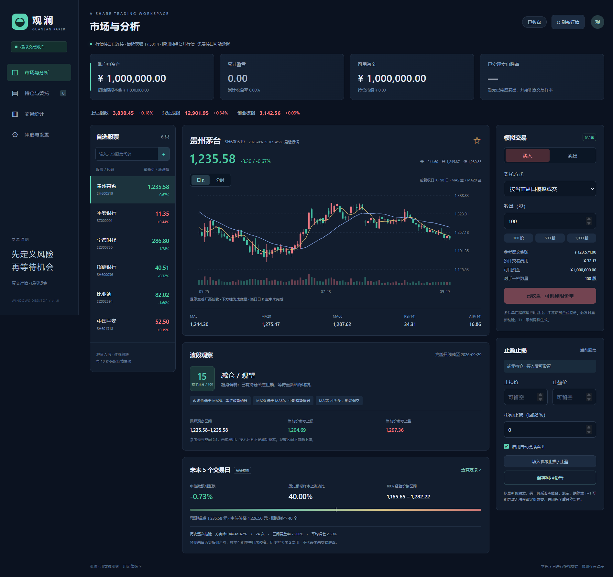

# 观澜 · A 股模拟交易

Windows 桌面工具，使用真实行情和本地虚拟账户，支持超短线、短线、波段与长线策略的选股、模拟买卖计划和规则策略自动交易。没有券商登录、券商交易密钥或真实下单接口。

## 盘前自动准备

- 程序运行时，非交易时段也自动准备成员的完整日线、公告和公司行为资料；长线及附加财务条件所需的财务资料同步预取。历史日线与公司行为检查完成后显示“盘前资料已准备 · 等待开盘核验”，不要求先取得当日实时成交报价。
- 资料失败或未就绪约每分钟自动重试；已准备或已核验项目每五分钟复查，仍遵守数据源冷却和 `Retry-After`。开盘及午间恢复后自动接续核验，无需点击“重新自动核验”；单股失败不会中断后续成员，大列表按最近检查时间轮转。
- 盘前先准备三个指数的历史日线；开盘后自动获取当日指数报价和全市场广度，市场环境改善仍需至少 120 秒的不同报价持续确认。免费来源持续失败时会保留具体原因并继续重试，不把失败当作准备完成。
- “已准备”表示历史资料准备进度，不表示已满足买入条件。昨日报价不用于今日价格基准确认，原有待对账状态保留；实际模拟买卖仍逐项核验交易时段、实时行情、价格基准、市场环境、入场信号及资金风控。程序关闭时不会执行准备或交易。

## 免费数据备用来源（1.8.5）

- 四类策略共用的市场广度优先使用腾讯全市场报价；失败、超时或有效报价覆盖不足时，切换新浪完整报价。界面展示本轮来源、切换原因与获取进度；不把不同来源的部分股票拼成完整快照。
- 新浪股票名单不可用时，独立获取东方财富沪深 A 股名单，验证分页、总数、排序、重复、上市状态和获取前后的一致性。名单最多缓存 30 分钟且不跨日；不因停牌或无报价排除证券。上市日期缺失时，只有当日公开发行资料明确证实尚未上市才排除，否则整份名单不可用。
- 公告目录增加巨潮备用源，支持其原始 PDF 的下载、解析、缓存与原件查看。东方财富和巨潮使用不同的公告编号，保留实际来源并校验证券、日期与附件身份；不能按相同标题把两个来源当成同一公告。请求共用队列、缓存及取消机制，强制重核验仍遵守服务端限流期限。
- 本次备用范围是市场广度、其证券名单和公告取证。普通选股的估值等指标仍沿用原来源；财务结构化字段、公司行为实施资料尚未全部拥有独立备用源。东方财富目录已成功、但其中某篇敏感公告原文失败时，仍保留待核验；整份研究材料可在主源失败后重新从巨潮取证。巨潮目录为空不能直接认定无风险。
- 保留指数 90 秒、广度 180 秒有效期、至少 1000 只且覆盖 80% 的有效报价，以及环境改善 120 秒持续确认。午休、收盘后或来源都不可用时仍可能待核验；增加备用来源不能保证免费接口持续可用。

## 四策略市场环境获取（1.8.4）

- 超短线、短线、波段和长线共用市场环境获取。重新自动核验同时重取市场环境与个股资料；手动规则检查也先刷新市场环境。正在获取的公共任务共用，界面显示获取阶段、进度及上次失败原因。
- 完整股票代码列表按北京时间日期缓存最多 30 分钟，数量变化或跨日即重新获取，并在报价结束后复查总数；缓存不包含股票报价。首次列表分页最多 3 个并发，同一主机仍保持请求间隔。选股与市场环境同时获取时共用数据任务，取消其中一项不取消另一项。
- 广度成功快照最多复用 30 秒，手动重试绕过已完成的报价缓存；原始行情时间保持不变。完整股票池、指数 90 秒/广度 180 秒有效期，以及市场环境改善至少 120 秒持续确认的要求保留，数据获取失败继续暂停新开仓。

## 账户保存容错（1.8.3）

- Windows 替换账户文件遇到 `EPERM`、`EACCES` 或 `EBUSY` 时，按 50/100/200/400 毫秒等待后最多重试 4 次；只重试原子替换，不重复执行成交或写入备份，不删除主文件。普通保存累计等待最多 750 毫秒；账户版本升级的备份和主文件分别适用此上限。其他错误直接报告。
- 重试耗尽后回滚本次内存变更并保持交易暂停；行情仍可更新，但不会自动清除错误或恢复交易。首次错误保留一次，后续行情刷新不再重复拼接。交易处理异常与账户保存失败分别提示。

## 自动核验恢复（1.8.2）

- 公司行为请求按来源主机排队，相邻请求至少间隔 250 毫秒。单条公告目录请求返回 HTTP 567 且没有有效 `Retry-After` 时，只暂停该请求至少 60 秒，其他股票继续独立取证；567 本身不能证明整个域名不可用。429 或明确的 `Retry-After` 保留同域名冷却，手动重核验不能绕过。1.8.2 修正了 1.8.1 将单条拒绝扩大到全域名的问题。
- 公司行为成功证据仍只在原 5 分钟有效期内复用，缓存可容纳多组自选；失败结果短暂复用 60 秒且保持不可用、原获取时间和不完整覆盖，不会因缓存变为核验通过。主动重核验可以重取本地失败缓存，但仍遵守来源冷却。
- 修复公告“现金股息”措辞漏识别，以及日期表头与首列连接后误把登记日当成派息日的问题。正文与表格的真实冲突、差异化分派继续阻断。手动重新核验的强制刷新也传递到策略日线请求，服务端重试期限仍生效。
- 核验详情区分真实接口拒绝和“本地暂停，本次未发送”，后者显示北京时间的允许再次尝试时点，不使用保存后会过时的剩余秒数；该时点只是本地允许重试的时间，不是数据源承诺恢复。资料恢复和核验通过后才能解除相关限制，不能把资料获取失败当作没有公司行为。



本仓库保存源码、构建配置和验证文档。本地构建的 Windows 免安装程序保存在 `dist/`；已发布版本的程序与源码压缩包通过仓库的 **Releases** 下载。

## 开始使用

1. 双击 `Guanlan-1.8.5-win-x64.exe`。首次启动需解压运行组件，请稍等片刻。
2. 联网后自动载入六只自选股、上证指数、深证成指和创业板指。输入六位股票代码可增加自选。
3. 默认模拟本金为 **100 万元**。在“策略与设置”可追加虚拟本金并查看追加记录，保留原账户和交易历史；也可备份后重置账户，重置本金范围为 1 万至 1 亿元。
4. “市场与分析”顶部的“策略 · 买卖计划”可按股票选择超短线、短线、波段或长线，显示各自的入场条件、退出规则、等待原因和止盈止损价；下方展示日 K、分时、技术指标与 5 个交易日的统计预测。选择保存到本地；自选与持仓持续监控，持仓沿用建仓时的策略。
5. 交易时段可按当前盘口模拟成交；休市期间可先建立限价条件单。
6. 信号显示“规则通过 · 可模拟”时，点击“按计划模拟买入”并确认，成交后自动保存动态风控计划。手动交易仍需自行设置止损价、止盈价或移动止损比例，并点击“保存风控设置”。
7. 在“持仓与委托”查看成交、撤销限价单、导出 CSV；在“交易统计”查看权益曲线、胜率、盈亏及最大回撤。
8. 左侧“选股”支持全市场条件筛选和文字描述选股；结果可加入自选或点击名称查看分析，也可点击“全部加入自动交易”，一次选择策略并加入全部分页候选。
9. 个股详情的“个股资料 · F10”提供公司、估值、财务年度对照与近期公告；通过“更新资料”刷新当前栏目。
10. “策略自动交易自选”支持按四类策略分组管理股票：划入模拟资金、加入股票并启用策略后，程序根据固定规则检查并自动模拟买卖，无需模型、密钥或付费模型服务。普通自选不会自动取得交易权限。

运行环境：Windows 10 / 11，64 位 x64；无需另装 Node.js 或 Python。读取行情需要网络。程序未使用代码签名证书。

## 市场环境与开仓确认（1.8.0）

- 自动策略结合上证指数、深证成指、创业板指的完整未复权日线趋势与沪深 A 股上涨家数占比识别偏强、中性、偏弱及待核验环境。至少两个指数向上且上涨占比不低于 55% 为偏强；至少两个指数向下或上涨占比不高于 35% 为偏弱；其余为中性。有效广度要求至少 1,000 只且覆盖不低于 80%。
- 偏弱或证据缺失、过期时暂停新开仓；中性使用单笔及策略总计划风险预算的 50%；偏强恢复已设置预算。指数 ATR/收盘价不低于 2.5% 时限制为半额并关闭突破。风险预算降低不强制卖出原持仓，也不代表能够锁定最大亏损。
- 环境改善须由不同来源时间的行情持续确认至少 120 秒；降级立即生效。指数报价有效期 90 秒、广度 180 秒，读取缓存不会延长来源时间。非交易时段不更新开仓权限。
- 自动开仓回踩须实际观察到锚点附近回踩、至少反弹 0.1 ATR 并站稳 60 秒；正常偏强时超短线、短线、波段另可观察前期完整日线高点突破，长线仍使用回踩。突破不追超过前高 0.5 ATR 的价格，初始止损为前高减 0.5 ATR，模型目标为前高加 3 ATR；含费盈亏比等原检查继续生效。日内高低价不能代替实际观察过程，断流后重新确认。
- 每批检查 20 只候选；最多对接近入场价位的 80 只候选进行额外连续报价采样。采样使用独立行情实例，不占用持仓报价队列或共享故障冷却；这仍受免费来源时延及可用性影响。每次模拟成交前重新核验并归档环境、原始报价时序与最终风险预算。
- 已有持仓保留原退出规则，不补仓。上述阈值为未完成回测及样本外验证的产品模板，不代表已证实的收益优势。

在“策略与设置”中输入追加金额并确认，即可追加虚拟本金。每次范围为 0.01 至 100,000,000 元，最多两位小数，累计投入上限为 1,000,000,000 元；资金先进入手动现金，可再划拨至各策略。追加记录通过独立资金流账簿保存，与策略间资金划拨分开。原始本金和交易历史保留，累计投入包含追加本金；盈亏扣除外部投入，收益率与最大回撤按剔除资金流的单位净值计算。权益曲线仍显示含资金流入的账户资产。账户升级后使用 1.8.0 或更高兼容版本，旧程序拒绝新格式以避免错误核算。

持仓须有当日有效估值，且不存在影响权益的待对账或待核验事项；盘中要求 90 秒内报价，午休可使用上午收盘前 90 秒内或之后的报价，盘后要求 15:00 或之后的收盘报价。保存失败会回滚本次追加并暂停交易；同一追加请求重试不会重复入账。

## 刷新性能与盘中公告查新（1.7.14）

- 自动成员较多时，界面仅推送变化的数据，复用未变化的列表行；公司行为核验只比较相关账务字段，并合并已经取得资料的小批核验。完整账户、历史证据、保存失败回滚及成交前复核继续保留。
- 已确认的交易时段内，公告目录使用独立于日线和报告下载的查新队列。待买入股票和持仓优先，目标间隔30秒；运行组的其他活跃成员轮转检查，目标间隔5分钟。每批最多20只、并发2；队列积压、网络或公开来源延迟会增加实际发现时间，这些间隔不是发现时限保证。
- 发现公告目录新增、更正、撤回或查新失败时，旧策略买入依据失效，须重新核验。成交前仍强制刷新，并在等待资料、行情之后及保存事务内核对公告版本和原始获取时间；普通持仓退出继续沿用既有规则，公司行为导致的价格或权益异常仍按原规则拦截。目录无法识别来源未反映的正文改动，也不提供完整新闻实时推送。

## 公告事实、事件阶段与待核验诊断（1.7.12）

- 区分内部管理制度、不减持承诺、临床申请受理／批准／试验结果、减持实施、解禁条件成就／上市安排、融资或投资终止、资产交易和诉讼。使用完整原文与阶段事实判断；临床常规研发提示不等于已失败，不减持承诺不等于实际减持，法规和责任条款里的“更正日”“不可撤销”不视作本篇公告修订。
- 减持按股东及股份来源保存数量、期间、合规与计划一致性；完成或期限届满且事实齐全才解除标题门槛。未来实际期间、进行中、未识别的主体、矛盾数据仍待核验。解禁保存规模、比例、合法程序和阶段，条件成就不强求尚未公告的上市日期；计划上市不表示已经卖出，也不保证可以成交。
- 临床受理、批准及结果通过时保留阶段观察提示；未出资投资终止、普通融资计划终止依据具体决议和影响声明核验。收购清算、未决诉讼、资产交易影响未明确时仍待核验。发行人明确揭示的异常交易与调整风险作为阻断依据；这些是产品事件规则，不是收益预测或交易所强制禁买规定。
- 预告支持无冒号的明确期间、前置区间和更多横线格式；不可比数据保留原始金额及不可比原因，不补同比、不自动通过。事实提取和准入判断分开，完整原文已读不等于风险通过。
- 诊断分别展示目录获取、正文获取、页面解析、事实字段、规则覆盖、事件影响及明确阻断。汇总从实际展示的逐股结果按公司去重；旧结果可重新分类显示，但需重新更新候选才按新规则计算。当前仍是14日公告窗口，不是持续维护的完整事件生命周期台账。

## 行业原始指标与财务模板适用性（1.7.11）

- “行业地位”可选择主营行业排名上限、细分业务排名上限、细分收入占比下限，支持主营路径、细分路径或二者满足其一。默认 3、1、30% 继承原产品偏好，可编辑，未经收益或样本外验证。只有明确启用的条件才参与候选与开仓复核，默认策略监控不附加行业排名要求；旧严格研究、旧个人条件不被静默替换。
- 数值与市场范围、地域、统计年份、比较指标、竞争者覆盖及来源关系同时展示。普通筛选使用用户已核验的证据记录，自动候选池收集公开报告并核验原文。人工证据、发行人引用第三方和独立取得第三方全文分别标明。仅上市公司排名不能冒充全行业排名；同口径排名或收入占比冲突进入待核验，不因读取顺序改变结论。
- 行业归属是分类事实，行业地位中的排名和收入占比可以量化；行业景气、技术壁垒与未来需求尚无统一数据和验证模型，本版不提供这些分数，也没有实现同行财务分位数。来源仍有覆盖限制，新增数字编辑不会自动补齐缺失的排名资料。
- 长线及普通非金融财务模板先核验行业适用性。银行、保险、证券等金融企业单列“模板不适用”，不以普通企业 60% 负债率门槛判断其财务好坏，也不因此自动放行。缺失、冲突、过期的分类单列待核验；分类来源为东方财富公司资料，使用原获取时间，24 小时有效。普通自定义原始财务指标仍按用户数值条件判断。
- 行业专用资本充足率、偿付能力、流动性等模板尚未实现，须先核验字段单位、主体和口径。非金融企业的默认财务阈值仍是产品模板，不代表已按所有行业校准。
- 新增股票保存本次明确选择的行业条件，资料重试沿用原条件，重启后保留，开仓前重新核验；已有成员的个人条件继续保留。行业条件通过仍须通过买点、资金、仓位和模拟成交约束。

## 财务指标与报告期统一（1.7.10）

- 长线默认使用最近完整年度加权 ROE ≥8%；最新季度／半年累计 ROE 单独观察，不乘倍数年化，也不再直接套用年度门槛。原有个人 `ROE` 条件仍表示最新累计 ROE，不静默改写已保存条件。
- 最新累计扣非归母净利润金额 >0、扣非同比 ≥0、营收同比 ≥0、经营现金流净额 >0 分别判断；亏损收窄但仍亏损不能通过盈利金额条件。负债率仍要求 0%–60%，估值规则保持原口径。阈值属于产品初始模板，未经收益验证，不是会计或交易所标准；筛选条件可编辑，实际新开仓仍检查内置策略和已保存的个人条件。
- 年度指标和最新累计指标各自显示报告期、原值、门槛及缺失／不符原因。最近一年年度 ROE 只需要一份有效年报；只有三年平均、盈利年数和现金流统计要求连续三份有效年报。
- 累计报告最低覆盖期按北京时间切换：1—4 月为上年三季报、5—8 月为当年一季报、9—10 月为当年半年报、11—12 月为当年三季报；已核实正式披露的新报告优先。年度 ROE 在 5 月起要求上年度年报。抓取时间不超过 6 小时不能代替报告期检查；重新抓取旧报告不会使其重新有效。产品明细仍按年报／半年报覆盖，不额外要求季度产品明细。
- 上述最低期是结合披露期限制定的数据有效性规则；期限依据为[上交所 2026 年上市规则第 5.2.2 条](https://www.sse.com.cn/lawandrules/sselawsrules2025/stocks/mainipo/c/c_20260424_10816589.shtml)及[深交所 2026 年上市规则第 5.2.2 条](https://docs.static.szse.cn/www/lawrules/rule/stock/W020260424747613955674.pdf)。预告、快报、预约披露不等于正式财报已发布。

## 财务与业绩预告分别判断（1.7.9）

- 长线买点与候选池保留正式财报的独立评估结果及报告期。预告待补不使半年报失效；未通过公告检查仍暂停新开仓，并展示具体原因。
- 业绩预告可以对应尚未结束的预测期间；快报仍须期间已经结束。“第三季度”按正文核验单季或累计，不能仅凭标题互相替代。字段缺失、期间冲突、获取或解析失败分别说明，不能解释成必须等待正式季报。
- 普通同比下降保留预告数值和提示，不再默认硬拦截。可选“预告/快报归母净利润同比下界”“扣非净利润同比下界”及自定义阈值；默认只观察。启用后只使用近 14 日当前可核实的公告，缺少预告不能以正式财报补填。明确不盈利、重大异常和未解决的数据冲突仍单独检查。
- 公司正式新财报已有明确披露记录但接口仍是旧期时，重新获取财务资料；仍不一致则显示“最新财报待同步”。预告或快报不会触发正式报告替换。既有成员的个人条件保留，新加入成员保存启用的业绩条件，买入前按当前原文复核。

## 行情与支持范围

- 根据数据用途选择腾讯、新浪或东方财富公开 HTTPS 接口。报价默认每 10 秒请求一次，可调整为 5–60 秒。分时、历史数据每 30 秒尝试更新；分析日线缓存 60 秒。
- 日线和分时按下表依次切换，每个请求最多 3.5 秒，整条切换链共用 12 秒期限。连接失败、临时 HTTP 错误（含 501）或数据无效时尝试下一来源；取消或整条链超时后停止，权限等不可重试 HTTP 错误不继续切换。错误提示显示数据类型和接口主机。
- 每只股票显示行情原始时间，状态栏另外显示最近请求时间。请求成功不等于报价刚刚发生。
- 免费公开接口可能延迟、限流、停用或改变格式，不保证交易所级别的逐笔实时；程序不会生成假行情填补空缺。
- 日 K 图、技术评分及统计预测使用前复权价；四类交易计划使用独立的未复权日线，与盘口价格保持一致。指标只使用完整收盘日线。
- 支持沪深主板、创业板和科创板 A 股；暂不支持北交所、ETF、基金、可转债、B 股及无涨跌停价格证券。自选最多 50 只。
- “选股”使用新浪证券列表和腾讯公开报价，财务及公告仍取原有东方财富资料，可叠加技术和基本面指标。新浪只提供代码，不混入其估值或报价字段；结果显示实际来源。新闻和行业估值模型尚未参与筛选。

### 多渠道用途（1.3）

| 场景 | 首选接口 | 备用接口与限制 |
| --- | --- | --- |
| 自选、持仓及指数报价 | 腾讯快照 | 新浪补充缺失、无效或盘中过期的股票报价；缺少明确涨跌停价格，仅供展示，暂停模拟成交 |
| 日 K、技术评分、统计预测 | 腾讯网页网关，前复权日线 | 腾讯旧入口 → 东方财富前复权日线 |
| 四类买卖计划、技术条件选股 | 腾讯网页网关，未复权日线 | 腾讯旧入口 → 东方财富未复权日线 |
| 当日分时 | 腾讯网页网关 | 腾讯旧入口 → 东方财富分时 |
| 全市场股票池、动态 PE 等快照条件 | 新浪按代码排序的证券列表 + 腾讯批量报价 | 每只股票全部指标取同一条腾讯报价，动态 PE 使用明确的动态字段；失败不发布部分池、不自动切换旧快照 |

- 一只股票的一份报价、一组日线或分时使用单一来源，不拼接不同来源的盘口字段或 K 线。页面、策略和技术选股结果显示实际来源；分时涨跌参考使用该分时响应的昨收，缺失时明确标为首点基准。
- 新来源的数据必须通过证券代码、日期、价格关系与成交量校验。新浪盘口数量和成交量按股读取；东方财富日线成交量从手换算为股，分时将每分钟成交手数换算并累加为股。
- 个股报价、日线与分时的连接或 HTTP 失败按用途分别冷却 30 秒，遵守服务端 `Retry-After`；到期后自动恢复首选尝试。某只股票的数据无效不禁用该来源的其他股票。手动强制刷新分析日线可以跳过普通冷却，不能跳过 `Retry-After`。选股列表与批量报价采用下文的独立请求期限和有限重试规则。
- 腾讯与新浪都不可用时提示失败；保留的旧报价仍显示原始时间，不能绕过模拟成交的新鲜度检查。新浪仅展示的限制同时在按钮、手动成交、条件单及风控执行处生效。
- 本次实测新浪报价、腾讯日线与分时、东方财富前复权及未复权日线和分时均可返回数据。东方财富日线此前也出现过空响应，单次成功不代表持续可用。BaoStock、Tushare 本版未接入。

## 个股资料 · 精简 F10（1.4）

选股结果、自选和持仓进入同一个个股详情。“公司与财务”展示公司名称、主营、东方财富行业分类、上市日期、总/流通市值、动态 PE、PB，以及最新报告期财务摘要和最近三个已返回年度的对照。“公告与事件”按需展示最近 30 条公告的标题、日期、来源分类，并可在系统浏览器打开公告正文或更多公告。

- 公司、财务、估值、公告分别请求，个别模块失败不阻止其他模块或 K 线显示。更新失败明确提示；如本次运行已有资料，则保留旧值及原获取时间。首次获取失败显示“数据暂不可用”。公告为空或获取失败不代表无风险事项。
- 财务来自东方财富 F10 数据服务：营收为营业总收入，利润包括归母及扣非归母，经营现金流为净额；金额从元换算为亿原币种，币种缺失明确标记。营收、利润、现金流为年初至报告期末累计值，ROE 使用来源加权口径，不自行年化，资产负债率为期末值。同比直接显示来源披露值，缺失不当作 0。
- 最新报告与年度对照均展示报告期、公告日期和来源数据更新日期。年度值可能包含后来修订，仅用于当前研究；本版不提供历史时点财务快照；财务可用于当前选股和长线计划的新建仓核对，技术评分不使用财务数据；四类策略筛选及新建仓均检查近期公告标题，敏感事项和资料不足会暂停候选或建仓。
- 估值使用东方财富单股行情的动态 PE（非 TTM）、PB 和市值，不与其他报价源拼接；保留负估值，报价时间未知时明确标记。
- 从选股打开时，可展开“入选依据”，查看当次条件、实际数值、快照与日线时间。历史选股依据与当前公司资料分开标明，不将新财报混入历史筛选结果。行情失败时仍可进入资料页，模拟成交继续执行原有报价校验。
- 缓存仅在本次运行内存在：公司 24 小时、财务 6 小时、公告 5 分钟、估值 1 分钟，最多保留 100 个股票/模块组合。进入股票或切换页签时检查缓存；“更新资料”强制更新当前栏目。资料页缓存不单独写入账户；买卖计划后台按需检查公告与财务，成交记录保存当次建仓核验依据。
- 外部链接仅根据校验后的股票代码与公告编号生成，限定东方财富公司资料和公告页面。公开接口可能延迟或变更，公告核查以原文为准；未实现结构化解禁/减持日历或同行比较。

## 投资策略与基本面叠加

### 产品原始指标与公司经营路径（1.7.8）

“选股”和“四策略候选池”增加可明确选择的产品指标、公司经营条件。默认策略监控继续使用原有规则；新研究条件默认仅观察，不预填所谓优秀产品分数或合格阈值。旧严格研究及已保存的个人条件保留，不能通过切换筛选模式自动删除。

- **产品指标**：收入、收入占比、收入同比、销量、销量同比、毛利率、毛利率同比变化；所有选中条件必须由同一个产品满足。只检查选中的指标，未选的缺项不阻塞。界面还保留本期与上期收入、成本、总收入、销量等计算原值、原始表格行、期间、单位和出处。
- **公司经营**：营业收入同比、扣非归母净利润同比、扣非归母净利润、经营现金流净额。独立使用财务数据判断，默认不下载产品报告或行业资料。它表示公司整体条件是否满足，产品数据不足仍显示不足，不称为产品前景通过。
- **阈值来源**：条件由用户自行设置，本版没有声称经回测有效的统一阈值。收入同比 =（本期收入 / 上年同期收入 − 1）× 100；毛利率 =（收入 − 成本）/ 收入 × 100；毛利率变化用百分点。分母非正、期间/单位不匹配或披露率与复算率冲突时不用于自动判断。公司同比采用来源披露口径，现金流与利润为已公告累计报告期，非 TTM。
- **原始资料只读**：只允许编辑筛选条件，不允许把缺失的原值手工改成达标。金额统一为人民币元（产品）或亿元（公司），销量必须选择原披露单位。缺失不当零，单有披露百分比但原始计算依据不足时保留展示、等待核验。
- **资料状态**：分别提示未请求、获取失败、原文解析未完成、尚未定位报告、当前表格未提取及数值口径冲突。获取或解析失败不能据此认定公司没有披露。单只股票的“经营与产品资料”支持查看、重试及按编辑后的条件重新判断；采用规则后仍需重新筛选，查看动作不修改账户和既有成员条件。
- **持续复核**：启用的研究条件随新加入的自动交易成员保存，开仓前重新读取当前来源并计算；观察模式不保存为额外门槛。资料检查超过 6 小时、未覆盖最低适用年报/半年报或产品公告目录未完整核验时保留待核验。明确披露的重大产品不利事实独立保留，不能被增长指标抵消。

本版支持可靠识别的产品表格布局，不保证每份报告都能提取；行业排名、竞争优势及未来产品前景没有转换成未经验证的自动分数。新增路径不改变行情、公告检查、策略入场条件、资金和模拟撮合规则。

在“策略与设置 → 投资策略 · 选股模板”点击“用此策略选股”，或直接使用选股器顶部的策略下拉框，自动带入可编辑的规则，无需复制开仓观察文案。提供超短线隔夜观察、短线动量跟踪、波段趋势预筛、长线质量估值四类模板。打开选股结果时，会同步选择对应的买卖计划；已有持仓沿用原计划。观察周期与默认阈值是研究起点，尚未验证历史收益。个人附加条件与修改后的筛选阈值参与当次选股；从结果单只或批量加入自动交易时，保存个人额外数值条件、ST 排除及研究标签，自定义选股保存全部数值条件。策略预设不重复固化为持续条件，后续每次新开仓检查内置策略与保存的个人条件。手动买卖计划仍按内置规则检查。

- 策略条件与“我的附加条件”分别标记，所有条件同时满足。切换或取消策略只替换策略部分，保留个人指标、股票范围、板块与 ST 设置；重新选择模板恢复该模板默认值。“清空条件”同时移除策略和个人条件。未加入自动交易的筛选编辑只在本次运行保存；加入时冻结的开仓条件会随账户持久化，之后改筛选不会改写已保存规则。
- 选定策略后，可输入“ROE大于10%，资产负债率小于60%，营收同比大于10%”，点击“追加并选股”。重复规则去重；与策略冲突或含不支持文字时整段不应用，保留现有条件和上次结果。已添加的条件可逐项修改或移除。未应用的输入保留，应用或清空后才能开始筛选。
- 基本面支持加权 ROE、资产负债率、营收同比、归母净利润同比、扣非净利润同比、经营现金流净额；PE、PB 与市值沿用行情快照。ROE 为来源报告期非年化值；营收、利润与经营现金流为年初至报告期末累计口径，同比使用来源披露值。经营现金流仅接受人民币财报，换算为亿元，负值保留。
- 财务筛选读取东方财富最新已公告财报，报告期、公告日期、更新日期及获取时点须可验证，不使用未来或刷新失败的报告。股票间报告期可能不同，结果逐只展示报告期、公告日期、来源、获取时间；打开详情时保留当次入选依据。资料修订不能用作历史时点证据，含财务条件时拒绝历史快照筛选。
- 四类策略模板统一执行公告检查，移除或修改指标不会取消。指标通过后检查最近 14 个自然日、最多 30 条公告标题，对敏感公告按需读取原文并执行已支持的事件规则；明确不利信号拦截。获取失败、来源错误或列表无法覆盖检查窗口均不放行。有限目录和命中正文检查不能证明没有风险；窗口外或未命中关键词的事件未经核验，也不能认定影响已消除。严格研究模式另行执行下文的公司报告和行业规则核验，两项检查均须满足，不提供一键确认即可解除的入口。
- 短线与超短线额外执行行情过滤：当日跌幅达到 5% 暂停候选（产品保守阈值，非交易所规则，未经收益验证）；行情缺失、时点不明或过期也单列待核验。公告扫描后重新获取候选的报价与盘口，再检查跌幅、跌停及退出买盘。波段与长线不套用这个 5% 阈值。界面分别显示条件快照与风险复核报价；不存在未执行的行情检查“通过”状态。
- 四类买卖计划均展示公告检查范围、命中标题与原文入口；提交模拟买入时强制重新获取公告与报价，成交记录保留核验依据。公告门槛限制策略新建仓，资料断线不会阻止已有持仓按原退出规则处理。没有正常候选但存在待核验股票时，匹配数量显示未知；风险资料缺失与指标缺失分别统计。四种策略的历史筛选因缺少当时公告证据而拒绝执行。
- 自定义筛选只报告指标匹配，明确标记“公告未核验”，不会对无条件全市场自动发起数千次公告请求。打开股票后的买卖计划会另行检查。自定义历史快照不混入今天公告，也不宣称已核验历史事件。手动交易不等于通过策略核验。
- 按快照 → 财务 → 日线逐步缩小候选，所有模板另做公告检查，短线与超短线再复核当前报价；每阶段最多 3 个并发请求，显示进度并支持取消。必需指标缺失不当作 0、不纳入匹配；全部候选无法判断时显示“无法筛选”，部分缺失明确标记。全市场财务与日线扫描可能较慢，可先限制范围或加市值、估值等条件。

## 财务质量与证据标签选股

在“选股”中可以组合数值指标与证据标签。此处的自定义证据标签使用人工研究记录；“策略自动交易自选”的四策略候选池在选择“严格研究筛选”时，由程序收集公开披露资料，并按下文列明的文本规则核验，无需逐股填写这些表单。默认“策略监控”不附加这些研究要求。两类记录分别标注来源，程序核验不会伪装成已人工审核。产品前景的评价是“现有证据支持”，不代表预测概率或收益保证。

- “财务质量与行业龙头”研究模板使用：最近连续三年扣非盈利年数 ≥3、平均年度加权 ROE ≥10%、最近年度 ROE ≥8%、三年经营现金流至少两年为正且合计 >0、最新资产负债率 ≤60%、最新报告期扣非利润 >0；同时要求财务专项核验、产品前景证据，以及“主行业前三或重要细分龙头”。模板仅用于普通非金融企业；财务专项核验须覆盖适用性、审计意见、债务逾期和重大会计更正。阈值为可编辑的研究起点，尚未验证收益。
- 最近一年年度 ROE 只需最近一份有效年报；三年平均、盈利年数及现金流统计必须有连续三份有效年报，保留各年度的报告、公告、更新日期和原值。年度新鲜度采用产品规则：1—4 月允许最近年报为前年，5 月起至少为上一年；报告尚未取得时不补零、不用半年报年化代替。最新报告期指标与年度指标分别标注。不同币种金额不混算。
- 标签可单独选择需求增长有依据、产品已商业化、竞争优势已证实、财务专项核验；“产品前景有证据支持”要求同一产品的需求、商业化、优势及反向证据核验全部通过，不跨产品拼接结论。
- 自动“产品前景”核验针对已披露经营事实，不是未来市场空间、股价或收益预测。逐产品显示需求、商业化、竞争优势及风险披露的通过／不符／待核验、原文与页码；未识别出产品与已识别但证据缺失分别说明。历史结果没有保存逐产品明细时显示未记录，不补造结论。
- 自动竞争优势核验保留同产品全市场前三排名，并增加有限的具名第三方来源量化比较：同期间、同产品、同规格／测试条件或同市场口径的单位成本、能耗、转换效率、能量密度、良品率、市场份额。只证明有据可核的单项优势；普通毛利、公司自身同比、专利数量或宣传不作为比较优势，引用来源与独立取得原文分别标注。行业地位条件仍单独核验，不能由这些单项优势替代。
- 产品风险可按明确对应产品的披露、明确引用原事项的完成整改与影响消除说明，或限定披露范围复核判断。后一路径要求经营重大变化明确披露、完整实质风险章节（包括明确援引且已取得的年度章节）和报告后相关公告覆盖，展示材料范围而不声称没有风险。实际不利事项未能定位具体产品、资料冲突、未核实扫描正文及覆盖缺失继续待核验；其他产品或其他事项的说明不能解除本项。
- 行业地位可选择主行业前三、重要细分行业龙头，或二者满足其一。主行业要求全市场竞争者口径的排名 ≤3；细分龙头要求排名第 1 且相关业务收入占比达到所选门槛（默认 30%）。每条排名保存市场、地域、销量／销售额／份额口径和统计年份。仅全国或全球市场口径可通过这项预设，区域市场证据列为待核验；同一市场口径采用最新统计年，旧年保留为依据记录。上市公司规模排名不能代替全市场排名。
- 证据库支持按股票新增、编辑、删除研究记录。每条记录保留研究对象、结论、核验状态、来源标题与链接、原文摘录、适用期间、发布日期、复核日期和有效期。新建默认草稿，人工核验后方可参与通过判断。缺失、过期、争议和相互矛盾的证据进入待核验，不默认为符合或不符合。
- 结果分别展示符合条件、证据待核验和证据条件不符合的股票；后两类仅包含进入证据阶段的量化候选。可查看逐项理由与当次证据快照。修改证据后需重新筛选；待核验及不符合记录不参与“全部加入自动交易”。从选股加入自动交易后，所选证据标签会作为附加新开仓条件，每轮及执行前读取当前证据；证据过期、撤销、缺失或读取失败暂停该股新开仓。标签失效对已有持仓只提示，不替代原退出规则。
- 文字支持“财务状况良好”“产品前景有证据支持”“需求增长有依据”“产品已商业化”“竞争优势已证实”“主行业前三或细分龙头”等明确短语，解析后显示实际条件。证据条件不支持历史行情快照筛选，避免用今天的研究结论解释历史。

## 条件与文字选股（1.2）

入口在左侧“市场与分析”下方的“选股”。页面按文字描述、已选条件、筛选结果排列，完整指标列表默认收起，可按名称搜索后添加。支持全部沪深 A 股或我的自选、四个板块与 ST / 退市标记排除，以及最新价、涨跌幅、换手率、量比、成交额、成交量、总市值、流通市值、动态市盈率、市净率、振幅 11 项快照指标，以及完整日线收盘、MA5/20/60、前一日均线、MACD 柱、RSI(14) 和日量比。

例如输入“主板，排除ST，股价10到30元，总市值50到300亿”，点击“文字选股”，会转换为可编辑的板块、排除项及上下限并执行。区间包含边界，“大于 / 小于”不含边界，“不超过 / 不低于”包含边界。所有数值条件同时满足，勾选的板块取并集。未选择策略时，文字选股完整替换当前条件；选择策略后，文字追加为个人条件，保留策略和已有个人条件；之后也可直接修改、增加或删除条件，再点击“开始选股”。文字解析在本地按明确规则执行，不调用大模型，不发送描述文本。

目前不支持任意行业名称、新闻语义、金叉等尚未支持的技术形态、通用复杂“或”逻辑及无判定规则的“有潜力”等主观判断。行业地位的固定二选一逻辑与上述证据标签另行支持；遇到未识别文字、错误单位、矛盾条件时明确报错，保留并标明上次结果，不忽略未识别部分继续筛选。例句是使用示范，不是策略推荐。筛选条件在本次运行期间保留，重启后恢复初始条件。

首次按代码排序取得新浪完整证券列表（每页 80 条，最多 3 个并发），核对前后总数、页长、顺序和重复；完整代码池在同一北京时间日期内最多复用 30 分钟，数量变化时重建。每轮逐批重新取得腾讯报价（每批 50 只），结束后再次核对列表总数。同主机请求启动间隔至少 150 毫秒，单次请求最多 8 秒，整轮最多 120 秒。临时连接错误、可重试 HTTP 错误及截断列表页最多重试一次；`Retry-After` 约束同主机的所有请求，超过 5 秒则本次明确失败，后续重试也遵守服务端指定时间。股票池或报价集合不完整时不发布结果。列表含北交所，按原有代码规则排除不支持的证券；当前规则也尚不支持 `302132` 和 `689009`，不将其混入已支持股票数量。

使用最新行情时，“开始选股”和“文字选股”（含示例）都会先重新获取行情，再自动筛选；本次实测全市场快照约需一分钟，技术、财务和公告检查另需时间。失败或取消保留并标明上次结果。主动选择历史快照时仍使用该快照，旧东方财富快照继续兼容。不随原有 5–60 秒账户行情刷新自动扫描。页面分别显示列表页数、报价股票数、来源、获取区间、可判断数量、缺失明细和原始报价时间；结果可以搜索、排序、分页、加入自选和进入分析。

**技术条件（1.2.2）**：支持“需要 MA20 向上且高于 MA60、收盘在 MA20 上方、MACD 为正、RSI 40–75、日量比不低于 0.6”。向上指当前完整日线 MA 高于前一根完整日线 MA；“上方 / 高于”严格大于，“不低于”包含相等。现有波段策略使用收盘不低于 MA20，示例按钮沿用该口径。条件可在界面中切换数值或其他日线价格指标作为比较对象。

技术筛选与四类买卖计划共用完整未复权日线指标，至少需要 61 根；只使用扫描开始时已经收盘的日线。MACD(12,26,9) 柱采用 2 × (DIF − DEA)，RSI 为 Wilder(14)，日量比为完整日成交量 ÷ 此前 20 根日线平均成交量（分母为零时不可判断）。日量比与行情快照量比分开。分析页采用前复权日线和不同历史长度，指标可能不同。

先按范围和快照条件过滤，若含财务条件则先核对财务，再最多 3 个并发请求通过者的技术日线；每次最新行情选股都会重新获取本次需要的日线。全市场扫描可能较慢，显示已完成数量并支持取消；取消保留上次结果。结果逐只显示实际日线日期、获取时间和条件核对，日期较早的日线不代表最新交易日。日线不足、数据无效、获取失败和不可计算指标分别提示；部分缺失明确标记，全部技术候选无法判断时不报告零匹配。历史快照仅保存原有快照字段，旧文件继续可用；带技术条件的历史筛选会明确拒绝，需切换最新行情或移除技术条件。

**盘前与缺失数据（1.2.1）**：只校验本次条件涉及的指标。例如仅筛“动态市盈率小于40倍”时，只要求市盈率有效；价格或时间缺失不再额外排除股票，分别显示“—”与“时间未知”，并说明无法确认指标对应时点。添加价格条件后才要求有效价格。市盈率等必需指标缺失仍不通过，也不当作 0。范围内没有股票具备完整的必需指标时，显示“数据暂不可用，本次无法筛选”，匹配数量为未知；只有存在可判断股票且都不满足条件时才显示零匹配。缺失明细按字段统计，同一只股票可出现在多项中，不可相加。

**明确选择历史快照**：成功取得完整股票池、每项快照指标至少有一个有效值且存在有效报价时间时，自动保存这一整份快照。最多保留最近 3 个北京时间获取日期，每个日期保留最近一份；整列指标或全部报价时间缺失不会替换已有历史。选择“筛选数据 → 历史快照”后点击“开始选股”，可在断网或重启后按原始数据筛选，页面持续显示“历史快照 · 非当前行情”以及原始获取和报价时间。所有条件使用同一份快照，不混用新旧字段；最新请求失败不会自动切换历史。新版本不能补回此前没有保存的快照。历史仍可包含个别缺失指标，筛选时按相同规则处理。

选股最新价为未复权价；百分比字段用百分数，成交额与市值用亿元，成交量用万手。量比、动态市盈率、市净率直接使用行情源口径；动态市盈率不是 TTM，负值保留，想筛正估值应明确设置大于 0。ST 排除根据名称中的 ST / 退市标记判断。选股行情和个股分析行情来源、更新时间可能不同，也可能与证券软件显示有差异；分页不是同一时刻的交易所快照。休市或停牌证券可能保留旧报价，逐只显示原始时间。筛选结果不等于买入信号；模拟下单仍重新获取报价并执行原有交易校验，仅收到新浪展示报价时拒绝成交。

腾讯选股动态 PE 使用官网 `dynamic_ratio` 字段，缺失时不使用普通或静态 PE 补齐；不同供应商的具体估值数值可能不同。腾讯将零估值、零量比及零市值标为不可用，选股按缺失处理；负估值保留。科创板原始成交量按股、其他已支持板块按手换算为万手。新来源通过了本次连续三轮完整联网校验，免费接口的长期可用性仍需实际观察。

## 策略自动交易自选（1.7.7）

默认加入表示纳入策略监控，不要求先取得行业排名、产品前景或完整研究报告。四策略分别检查自己的实时入场规则，长线仍检查财务与估值；必要行情、公告风险、资金、仓位、盘口和交易约束照常执行。从选股结果加入时保存个人额外条件（自定义选股保存全部条件），不重复保存策略预设；个人研究标签仍按所选要求检查。界面区分等待检查、条件通过待复核、等待买点、数据待补齐、风险拦截、资金或仓位受限、暂停和持仓跟踪。已有持仓继续原退出计划。

1.7.6 起，默认策略监控、策略选股和四策略候选池会按需读取当前 14 日完整公告目录命中的敏感公告原文；不为这项检查采集年报或行业资料。目录不完整、过期或标题明确不利时继续阻断；下载失败、解析缺页及尚无适用规则分别保留具体原因。执行前重新取目录并按编号、股票、标题和日期匹配正文，新公告不能复用旧公告的通过状态，持仓退出不等待正文下载。

业绩预告／快报增加有限的公告门槛规则：标题与原文须指向同一个已结束累计期间，归母及扣非利润当期／上期、单位和同比必须完整核实并算术一致；当期区间下限为正且同比区间不下降，且无更正、冲突或已识别实质异常，才能解除这一篇公告的敏感标题门槛。跨页、表格列不明、追溯调整尚未绑定比较口径、未来期间或实质异常无法判断时仍待核验。明确亏损、下滑或不利事项继续拦截。这是产品的保守事件规则，不是交易所规定；预告仍是预测，快报仍是初步核算，均不代替长线实际财报条件、技术买点或成交检查。

旧账户升级前自动备份，账户版本升级为 5。旧候选池自动附加的共同财务、行业、产品研究以及已生成的策略筛选规则从持续条件移除；不同于系统模板的个人条件保留，原条件快照留在成员的 `legacyPoolConditions`。旧候选结论作为历史诊断，不再阻断默认监控。资金、运行状态、成交与持仓退出计划保持原值；旧版程序不能读取新版本账户。

入口为左侧“策略自动交易自选”。个股详情、自选和选股结果也可点击“加入自动交易”，选择超短线、短线、波段或长线。加入已启用策略表示授权其持续按规则检查和模拟买卖，不表示立即买入。同一股票只属于一个自动交易策略，可同时出现在普通自选。已有手动持仓或待执行委托不会自动接管。

选股结果顶部的“全部加入自动交易”覆盖本次全部分页候选，不受结果内名称搜索影响，不包含风险排除及待核验列表。默认带入当次选股策略，自定义选股默认波段，可在弹窗调整。移除了自动交易原有 50 只上限，单次接受最多 15,000 项（与选股股票池结构上界一致）；普通自选仍最多 50 只。批量请求去重后分批获取行情，一次保存新增成员，逐项列出已加入、跳过及未加入原因；重复加入保留现有归属和退出安排。条件未应用、正在筛选、筛选失败或结果不可用时，需成功重筛后再批量加入。历史快照候选可以加入，但自动交易须重新核验当前数据。批量加入不自动划款或启用暂停的策略。保存个人额外数值条件、ST 排除和研究标签，自定义选股保存全部数值条件；新开仓时与内置策略同时检查，不重复保存策略预设，不继承股票范围、板块和排序，不改写原退出规则。已有归属的股票仍跳过，不覆盖原有条件。自动交易成员支持名称/代码搜索、仅看持仓和每页 30 只分页，原始报价时间随保存的报价保留。

### 手动更新四策略候选池

“策略自动交易自选”顶部的“更新四策略候选池”由用户手动触发，不定时、不限制每天次数，也不要求交易时段；同一时间只执行一个选股任务，支持取消。它与检查已有成员买卖条件的“立即检查一次”分别执行。休市时按最近有效交易日资料筛选并显示真实行情日期，不把盘后或周末价格当作实时成交报价。

- 默认“策略监控”扫描沪深全部 A 股，排除 ST / 退市标记，分别按四策略自己的数值条件和公告风险筛选，不要求同时满足四种策略，不叠加三年财务质量、行业地位或产品前景研究。长线使用自身财务和估值条件，其他策略不会因共同财务资料缺失而被阻断。默认模式不批量下载公司年报和行业研究正文。
- 可选择“严格研究筛选”，在各策略基础条件之上追加“财务质量与行业龙头”模板及自动研究；下述全文采集、OCR、行业及研究证据规则适用于严格模式。严格筛选新增的成员保存严格共同条件，每次开仓前继续核验，普通扫描不能授予严格资格。已有成员不会因切换本轮筛选模式而改变其模式、归属或个人条件。
- 本轮量化筛选在行情加载后固定观察时点，财务报告日期、完整日线计算、缓存和日期比较使用同一基准；跨收盘或午夜不混入本轮基准之后的日线。严格模式分别显示尝试研究、资料收集完整及研究条件通过的公司数；“资料收集完整”仍可能存在扫描页内容待核验，不代表研究通过。下载、解析、日线、公告和资料缺项可重叠，不能相加作为公司总数。
- 候选更新按行情条件、结构化财务、完整日线、公告与研究资料分层执行，四策略共用可复用的数据。行情每轮刷新；完整财务数据最多缓存 6 小时，完整日线仅在交易日、数据源及未复权价格基准一致时复用，重启后仍可命中。失败、缺项、过期或价格基准变化重新获取；缓存不会补齐缺失证据。财务结论对应原获取时点，窗口内新披露或修订可能尚未反映，到期后的下一次更新重新获取。结果保存各阶段耗时与缓存命中数。
- PDF 最多由两个独立进程处理，大文档使用新进程并独占解析资源。先读取整份文档的原生文字，再对缺字、乱码或文字层未覆盖的主体扫描页执行 OCR；完整原文复用已有缓存，执行超时或内存回收保留已完成页供重试继续。复用进程达到内存上限时，仅允许在原解析执行预算内用新进程重试一次，内存硬限不变，并记录内存与重试诊断。缺页断点保持不完整，OCR 数值仍不直接作为自动事实；不会仅凭选取数页就宣称全文核验通过。运行进度每秒单独更新阶段、耗时和排队数，避免反复复制完整历史结果。
- 出现待核验时可点击“重试失败资料”。先重新获取行情并刷新量化资格，再对入围公司复用身份一致的有效正文、补抓缺失资料；未完整解析的 PDF 保留已验证的完成页，仅重试失败页，不把识别失败缓存当作最终结果。已完整识别但事实仍未可靠核对的 OCR 不因反复识别自动放行。与完整更新互斥，可随时取消，取消不替换上次候选结果，已成功取得的资料缓存可供下次复用。持仓归属和退出计划继续保留。
- 自动核验规则版本 6 支持已验证格式的产品清单、销量及收入表格，保留表头、单位、期间、页码和行号，并校验同比或收入占比的算术关系；分地区收入、税费项不作为产品。债务复核可汇总明确类别及不适用证明，但单项无逾期不能代替全公司债务结论。自动核验使用固定文本规则，识别对应产品的已发生需求与商业化事实、可追溯市场排名或限定的量化比较，以及明确的行业适用性、审计、债务和会计更正披露。它不进行全面智能研究，不能理解任意报告措辞、复杂表格、行业竞争关系或全部新闻。获取完整报告也可能因无法可靠识别主体、期间或事实而列为“资料不足”；财务数值达标不能替代专项核验。旧版保存的结果需在新版重试资料或重新筛选后才会按新规则生成。
- 语义规则保守恢复同页审计意见、排名引用及明确产品列表的断行，包括已验证的“数控龙门／卧式／立式加工中心”词中换行，记录页码和行号；章节标题只关联紧邻且明确选中的选项。不跨页、跨产品拼接事实，不将“主营、内销、外销”当产品。同一产品销量后紧接的同比增长可关联，收入增长仍不替代需求增长。行业检索及归属使用与报告身份绑定的公司名称，不把“子公司名称”或“主要经营”等表头当作发行人别名。
- 资料来自东方财富公告目录、选定的年报和半年报全文，以及近期命中风险／经营关键词或敏感事件标题的公告正文；并未取得目录内全部公告正文。正文接口返回节选、空正文、过短正文或无效页码时，在公告身份核对通过后读取附件。PDF 逐页优先读取文字层，缺字、乱码或文字层未覆盖主体扫描内容时做本地中英文 OCR；PNG、JPEG、WebP、BMP 可识别图片文字。语言包随程序附带，不上传文件，不在线下载识别模型。Word／Excel 附件本版尚不解析，遇到会保留具体原因和待核验状态。
- 解析版本 4 保留逐页文字、页码、提取方式、OCR 置信度、公告身份及文件 hash。检查大幅或相邻分块图像所在区域的文字覆盖，避免把“原生页眉＋扫描正文”判为完整文字；普通小图标不因此触发整页 OCR。版本 3 的原生页需要重新检查；因乱码转入 OCR 的完成页也会先重查文字层，新规则通过后恢复原生文字，否则复用已有有效 OCR。身份、原件和解析设置一致时才迁移可验证的完成页，重查标记随断点保留；公司和行业 PDF 的旧版本缓存不能绕过检查。复选框和列表符号仅按已验证字体、字形和上下文转换；匿名字体仅在内嵌字体名称完整一致且互斥选项语法匹配时使用限定映射，保留字体核验依据、原始文字及映射记录。未知字形继续待核验。只有文字项、绘制操作与注释均为空的页面，或与已目视核对登记完全相同的原件哈希／页数／页码，才能标为非正文，并保留逐页记录；不普遍跳过首末页。低置信、超限或解析失败不冒充完整读取。OCR 置信度不是事实准确率，数字、单位、表格或否定词未可靠核对则待核验。所需报告、来源身份或后续公告覆盖不完整时不放行，也不使用旧报告替代。
- 有效目录中的敏感标题不再阻止入围公司取得原文。业绩预告／快报及其他已支持事件按上文的事实和阶段规则判断；未知类型明确提示规则未支持，不套用诉讼结案措辞。诉讼原被告身份、阶段与已履行事实分别展示，反向陈述、扫描内容或含糊影响继续待核验；减持计划取消仍要求明确未实施和对应影响。明确不利标题、目录缺失仍拦截。发布前检查目录有效性；实际新开仓重新按当前目录逐篇匹配原文，不直接复用旧通过状态。
- 程序另接入弗若斯特沙利文公开目录和原文：每家公司最多 2 个关键词、每词首页 5 项、3 份原文，核对官方详情正文或实际 PDF、发行人、统计年份、地域、指标及全行业分母。搜索结果、报告介绍、收费未开放原文、无法核实的图表均不作通过证据；当前未覆盖全部行业协会和研究机构。行业研究缓存独立保存（内存缓存按序列化体积最多 64 MiB、磁盘最多 256 MiB／128 家，6 小时内复用；网络失败缓存 5 分钟，显式重试跳过失败结果）。行业原文随开仓依据一起归档，原文撤回及同口径排名冲突会阻断旧结论。
- 行业排名可使用发行人报告中对具名协会或研究机构、报告／统计年份、指标和全国／全球市场的引用，记录明确标注“发行人引用第三方，第三方全文未独立取得”。这不是对第三方原始统计的独立验证；仅上市公司、地区、会员、参评或样本排名不能直接满足全市场竞争者条件。无法确认具体口径或存在相反披露时保留待核验。
- 普通限制命中后的 PDF 可进入独立的大附件重试：最多 384 MiB、1200 页、200 万字、300 秒；采用文件范围读取并保留完整性核验。可信文字层短公告不再仅因少于 40 字拒绝，扫描表格仍待可靠核对。全文请求最多 3 个并发，解析由独立进程有界调度；只处理数值筛选入围公司的选定资料。相关公告默认每批 8 篇并继续下一批。单附件最多 128 MiB、PDF 最多 600 页／80 万字、渲染最多 2400 万像素。下载与解析执行各有最长 120 秒预算，排队不占用解析执行期限或网络槽，并记录分阶段耗时；单公司本轮正文及页级来源总量最多 80 MiB。超过资源限制明确记为覆盖不足，不截断后放行。
- 正文缓存目标 256 MiB、解析副本目标 128 MiB，含资料索引的文字缓存总计最多 384 MiB；附件原件最多 512 MiB／30 天。当前候选及本批入围公司的正文、索引不因普通缓存数量上限被逐出，仍受总字节上限约束；优先清理可重建的重复解析副本和不再保留的资料。同一原件升级解析版本时，在身份、解析条件和可复用完整页核对通过后，以新结果置换旧副本；新结果成功写入前保留旧缓存，避免旧版本占位导致重复解析。容量确实不足时单独提示未能缓存，不改变本次已取得原文的核验结果；下次可能重新获取。重启恢复候选保留范围，解析版本变化重新解析仍有效的原件。
- 本轮暂缓或临时失败的公告进入收尾恢复队列，最多 2 轮、合计 65 秒，遵守服务器冷却及取消；不重新下载已成功全文。价格与公司行为资料独立支持有限网络重试。资料请求沿用 Electron 的系统代理和证书校验。可恢复的网络故障与临时 HTTP 错误采用有总期限的有限重试；同一主机连续失败时暂缓请求并显示具体原因，手动资料重试允许恢复探测，但遵守服务器的 Retry-After。目录、正文、下载、解析分别记录错误与尝试次数。正文临时失败时可使用此前核验且与当前公告身份一致的附件链接；首次未知附件地址不猜测，也不因网络失败放宽选股条件。
- 重复更新刷新公告目录，复用身份、元数据和解析版本未变化的结果；识别失败的结果也可缓存，但仍然待核验。修订报告、实际取得的文件 hash 或解析版本变化会重新处理，不回退到已被替代的旧报告。同编号、标题、日期和报告期均未变化的服务端静默替换，无法在仍复用本地缓存期间自动识别。
- 更新结果显示量化入围数、实际程序核验数、通过／不符／资料不足数量，以及三类研究资料的缺项统计；同一公司可有多类缺项，不能把分类数量相加当作公司数。逐股展开可查看程序核验理由、来源与原文摘录。资料获取失败或公开披露不能支持结论时暂停新开仓；核验通过仅代表本次取得资料符合规则，不代表完整审计、未来盈利或公司没有其他风险。
- 成功后统一保存名单差异：符合者新增；已有监控成员无论本轮通过、不符或资料不足均保留归属、个人条件和退出安排，筛选结论作为诊断。保留监控不等于筛选通过。默认成员每轮按实时策略判断，不被历史候选结论挡住；严格成员仍须严格资格和持续条件通过，平仓后重新进行严格筛选。手动持仓及待执行委托不自动接管。
- 新股票同时命中多个策略时，依次按超短线、短线、波段、长线分配一个执行归属，并保留匹配标签；此顺序不是收益排名。已有成员不自动换组。
- 本轮模式及结果随账户保存。其他入口新增的成员始终按默认策略监控，不继承上次严格筛选的共同门槛。名单更新不划款、不启用暂停的策略；已运行策略仍须通过当前行情、公告、资金和盘口等独立执行检查。
- 获取失败、取消或保存失败不应用半份名单；扫描期间账户重置或成员授权变化使旧任务失效。持仓退出不等待全市场扫描。结果展示新增、保留、移出、待核验、持仓保留、归属冲突及原因，以及实际数据日期与覆盖数量。

旧版严格研究流程的真实公开资料测试仍有下载、解析及事实核验缺项，未取得全部研究条件通过的公司。本版将这组要求设为可选严格模式，不将缺项改判为通过。默认模式已完成隔离账户的批量监控、模拟买入与 T+1 行为验证；这些可控数据测试不代表真实市场当前有符合条件的买点，也不证明策略收益。详见 [验证记录](docs/verification.md)。

### 固定规则与授权

- 决策直接使用本地四类策略规则，不接入大模型、不需要 API Key、没有模型调用费用，也不训练模型或自动优化策略。行情、日线、公告及长线所需财务估值仍通过原有公开数据接口联网获取；不会向模型服务发送账户和持仓。
- 每组按每批最多 20 只分批检查全部候选，最多并行 2 组、各批资料最多 3 个并发。尚未完成时，在后续行情刷新继续下一批，策略组公平轮换；整轮完成后再等待 300 秒，启用策略、新增成员和手动检查可提前触发。运行状态展示本轮已处理、剩余数量（含资料缺失及规则拦截）；完整轮次耗时取决于候选数量与接口速度，不保证 5 分钟内检查全部股票。
- 自动交易报价与批量加入报价按每批最多 80 只请求，报价网络请求合计最多 3 个并发；大批次不会把全部网络请求提前塞入队列。常规行情刷新只处理自选、持仓、挂单、当前详情和指数，未持仓的自动候选由规则检查批次按需获取；持仓资料使用独立扫描队列，持仓退出不等待整批候选扫描完成。
- 超短线和短线检查各自的均线、动量、成交活跃及回踩确认；波段检查 MA20 / MA60 趋势与回踩；长线额外核验财务与估值。各组页面展示具体入场与退出条件，所有入场还须通过公告、行情有效性、含费盈亏比和资金风险限制。未通过时记录等待或拦截原因，不下单。
- 仅严格研究成员具有候选资格门槛：未通过时持续条件明确跳过并引用前置原因，需严格筛选重新核验。默认成员的候选结论只作历史诊断；每只股票保留最近监控结果，不依赖只保存最近 500 条的执行日志来统计整个大股票池。
- 趋势未通过时逐项显示未达标指标、实际数值和要求；已通过的财务条件不重复作为趋势拒绝原因。成员列表与核验详情分别显示本次自动核验原因和公司行为资料状态，例如公司行为资料已核验但完整日线不足 61 根时，仍等待日线；只有价格基准等检查全部通过才解除原有交易阻断。
- 所有条件通过才申请新建仓；单股仓位上限作为目标上限，实际数量再按组内可用资金、含费计划风险、总仓位、盘口数量与申报规则共同确定，不保证达到目标仓位。已有持仓不加仓；继续按保存的止损止盈、趋势失效和持有期限规则退出。日线驱动的计划价调整使用固定公式，不属于自我学习。
- 买入前强制刷新资料、待买股票和全部持仓报价，再次核对策略、授权、账户版本、资金、仓位及交易约束，按当前有效计划执行并记录实际依据。预算涉及的持仓报价须为当日 90 秒内有效价格；无法核验时暂停新买，避免旧估值放大仓位预算。决策有效期最长 120 秒；暂停、移出、手动交易或重置等账户变动会使旧意图失效。提交串行执行，持仓退出独立随行情刷新处理。
- 从 1.5 版升级时先备份账户，原运行组一次性切为“暂停新开仓”，可查看规则后重新启用；原暂停/全部停止状态保持。持仓、资金、历史记录及原退出目标保留，不把历史模型决策改写为规则决策。规则版后续正常重启保持已保存模式。旧 `agency-model.json` 不再读取、解密或调用，文件原样保留。

### 资金、状态和统计

- 首次引入自动交易时，原有资金、持仓和历史交易保留手动归属，原策略风控继续有效，不把历史交易追记为自动交易业绩。四个策略账本初始资金均为零，需要从手动现金划拨。总现金始终等于各账本现金之和，策略不能借用其他组或手动资金。持仓资金不可直接转出。
- 每组独立设置单股仓位、总仓位、持仓数量、单笔计划风险、计划风险合计和含费盈亏比。默认分别为 30%、80%、5 只、0.5%、2%、2:1；这些是产品配置，不是经回测验证的最优参数。实际亏损仍可因跳空、T+1 和流动性超过按止损价估计的计划风险。持仓保留建仓参数，禁止加仓。
- “暂停新开仓”仍管理持仓与退出；“全部停止”同时停止自动卖出。“移出”有持仓股票进入平仓后移除；“尽快退出”保存退出意向，不保证立即成交。T+1 或一档不足时保留剩余退出目标，重启继续执行。人工卖出仍归原策略账本并记录人工干预。
- 胜率按完整建仓至平仓的交易周期计算，部分卖出不重复计胜负，平盘也计分母，展示完整轮次数。盈亏含实际交易费用，现金划拨不计收益；策略净值按份额调整资金流，回撤不因划入/划出而凭空变化。
- 决策记录区区分规则判断、程序拦截和实际成交，保留最近 500 条检查日志及输入证据；所有成交、资金划拨、对账流水和未完成退出意图保存在账户中。没有成交不能显示已执行。

### 公司行为与运行边界

- 1.7.0 首次读取旧账户时先保存完整备份，再升级自动交易账本格式；权益账本版本 2 引入股份可卖日期和股息税预留，版本 3 引入持续开仓条件，当前版本 4 保存候选池资格及共同标准。旧程序拒绝读取新版账本，避免忽略权益、开仓条件或待核验阻断。升级本身不会自动扫描或改写成员名单。请使用本次新构建或兼容版本。
- 自动收集东方财富分配方案、分红明细、历史公告及实施公告正文，核对证券身份、每十股/每股口径和关键日期。历史公告分页覆盖持仓期间；覆盖不完整、来源冲突、数据过期及实施后更正均不当作检查通过。资料自动附在“核验详情”中，可直接打开公告；“重新自动核验”支持单只股票或整组，取证不要求交易时段。
- 支持资料完整的标准现金分红，以及明确来自股票发行溢价、个人免税且上市日期已确认的整数转增。按历史成交重建登记日权益，区分登记、除权、现金到账、新增股份上市可卖日期；清仓或移出后仍追踪原策略、原周期的分红。除权时登记应收，并按标准实施公式校正当前风控价；保留原始成交和计划。账户保存失败回滚，重启不会重复入账。
- 现金分红按境内个人普通 A 股的递延扣税规则计算，预计未扣税额另作预留，不用于新开仓或划出。净权益＝现金＋持仓市值＋应收分红－预计股息税，盈亏中显示应收与税额，预留不是已经支付的税款。税务依据为[财税〔2015〕101号](https://www.chinatax.gov.cn/n810341/n810755/c1797427/content.html)及[财税〔2012〕85号](https://www.csrc.gov.cn/csrc/c100028/c1002394/content.shtml)，核验日期 2026-10-09；仅支持能明确重建税务批次的场景，同日回买、复杂股份变化及无法确认的税务边界保留异常。
- 公司行为检查在旧止损触发前执行。无法核对的持仓或历史权益暂停受影响股票交易，并暂停所属策略的新开仓和划拨，净值不参与比较；没有权益影响的候选资料异常仅拦截该股票，不拖住整组。正常策略入场的敏感公告检查仍独立执行。
- 已完成当日价格基准核验后，日线暂时获取失败、缺失或过期不再单独阻断已存止盈止损价位及待完成的退出目标；日线调价、趋势和期限复核暂停。此时仍要求报价昨收与已核验基准一致、公司行为和人工对账记录未改变、无待对账事项，并保留新鲜报价、T+1、交易时段及盘口约束；整份资料暂缺时，公司行为核验仅可沿用原五分钟有效期。跨日或基准变化须重新核验，不将历史核验当作新开仓许可。
- **仍有不支持自动入账的事件。** 现金与转增混合分配、差异化分派、送红股税基不明、配股、合并、零碎股份、转增后税务批次无法重建等进入异常列表，附资料和原因。人工对账作为异常处理保留，必须填写依据，不提供一键清除风险；人工净分红不能用来推算除权价。完成后仍须通过行情基准和交易约束检查。
- 自动交易仅在本机程序运行、网络与必要数据有效时工作。关闭、休眠或断线期间不执行，不回放错过的交易；重启恢复资金与退出目标，重新核验数据后运行。恢复自动备份时全部自动交易组停止，避免以回退状态继续开仓。
- 自动交易使用已核对沪深交易所公告的 **2026 年交易日历**，仅在支持的连续竞价时段模拟成交；未知年份暂停自动交易，需更新经过核验的日历。当前资料不覆盖个股临时停牌或未来临时休市，报价仍需通过独立校验。来源见 `core/trading-calendar.cjs`。

## 模拟成交规则

- 仅在北京时间工作日 **09:30–11:30、13:00–14:57** 连续竞价时段撮合。集合竞价、盘后不撮合。
- 还必须有当日、90 秒内、有效价格及成交量的报价；无当日新行情的节假日自动暂停。时段判断不单独维护交易所节假日历。
- T+1：当日买入当日不可卖；下一交易日有有效报价时可卖。系统按北京时间购买日期记录批次。
- 主板、创业板买入以 100 股为单位；科创板最低 200 股，之后可按 1 股递增。卖出可卖余额不足标准数量时须一次卖完。
- 买入按卖一加滑点，卖出按买一减滑点。默认每股滑点 0.01 元；价格不可越过接口提供的涨跌停价。
- 按对手一档可见数量保守校验。同一时间戳、同一股票、同一方向的盘口数量不会被重复使用。手动单和条件单整笔成交；风控卖出可按可见数量分次退出。
- 不模拟真实排队顺序、盘口冲击或完整成交概率。暂停交易、盘口为空、跌停卖不出等情况下，止损可能继续等待。
- 默认佣金万分之 2.5，单笔最低 5 元；卖出印花税万分之 5；双边过户费万分之 0.1。各项可调整；实际券商收费可能不同。
- 默认单股持仓上限为账户权益的 30%，禁止融资、做空及透支。条件单不冻结现金或股份，执行时检查；余额或数量不足时保留并显示原因。
- 条件单长期有效，最多 100 条待执行单；重启后继续监控。新报价先处理风控退出，再处理条件单。重启前已经发生而后又恢复的瞬时触发，不会回溯成交。
- 止盈止损只在程序运行、网络正常、报价有效时监控。关闭程序或电脑休眠后停止执行。到价不保证以触发价成交，跳空与 T+1 约束照常生效。
- **公司行为自动处理有明确范围。** 手动账户仍需在除权除息前结束该轮持仓模拟；自动交易账户按上述规则处理标准现金分红和已核实的免税转增，其他事件附资料进入异常处理，未经核实的权益不可用于策略比较。

## 分析与预测方法

技术概览使用 MA5 / MA20 / MA60、MACD(12,26,9)、Wilder RSI(14)、近 14 日平均真实波幅 ATR，以及成交量。0–100 分是规则评分，不是上涨概率。评分与可执行交易计划分开展示；不会根据评分自动买入。

5 个交易日预测将近 5 日收益、20 日收益、相对 MA20 偏离和 20 日波动率作为特征，按固定比例缩放后，选取最多 40 个最相似历史时点。仅使用其后 5 日结果在预测时点已经全部发生的样本。用收益中位数预测价格，用 10% / 90% 分位数显示 80% 经验区间；上涨占比为这些历史样本中正收益的比例。训练样本可能重叠，概率未校准，区间不保证未来覆盖率。

历史验证最多使用近 125 个交易日，以 5 个交易日为步长，每次只用当时已知数据重新预测。方向命中率、经验区间覆盖率、平均绝对收益误差与样本数同时展示。验证不计费用、不模拟执行，不能当作交易收益或交易胜率。盘中未完成的日 K 不进入模型。

## 四类买卖计划与动态风控

入口为“市场与分析 → 策略 · 买卖计划”，共用风险参数在“策略与设置 → 四策略共用风险参数”。每只股票可独立选择超短线、短线、波段或长线，重启后保留。扫描覆盖全部自选、持仓和当前查看股票，切换页面或选中其他股票不会停止自选和持仓的监控；未扫描全市场。行情按设置的 5–60 秒刷新，未复权日线每分钟尝试更新，最多 3 个并发请求，日线请求不会阻塞原有风控报价循环。免费接口可能延迟。

各策略均使用完整未复权日线，回踩区域为对应入场均线 −0.25 ATR 至 +0.75 ATR，盘中价还需不低于入场均线、今开和昨收。目标来自已完成日线的历史压力，空间不足时不人为抬高目标。超短线依然遵守 A 股 T+1，不能在买入当天卖出。

| 策略 | 入场与数据条件 | 初始价位与退出 |
| --- | --- | --- |
| 超短线 | 收盘高于 MA5，MA5 上行且高于 MA20，MACD 为正，RSI 50–75，日量比 1.2–3；当日成交额至少 2 亿元、换手率 2%–15%；MA5 回踩确认 | 止损为 MA5 与近 3 日低点较低值减 0.25 ATR，目标近 5 日高点；跌破 MA5 −0.5 ATR、MA5 不再高于 MA20，或买入日后满 3 根完整日线触发退出 |
| 短线 | 收盘不低于 MA5，MA5 高于 MA20 且 MA20 上行，MACD 为正，RSI 45–75，日量比至少 1；当日成交额至少 1 亿元；MA5 回踩确认 | 止损为 MA5 与近 5 日低点较低值减 0.25 ATR，目标近 20 日高点；MA5 低于 MA20、跌破 MA20 −0.5 ATR，或买入日后满 10 根完整日线触发退出 |
| 波段 | 收盘不低于 MA20，MA20 上行且高于 MA60，MACD 为正，RSI 40–75，日量比至少 0.6；MA20 回踩确认 | 沿用原规则：止损为 MA20 与近 5 日低点较低值减 0.25 ATR，目标近 20 日高点；趋势失效，或买入日后满 15 根新日线仍未上涨触发退出 |
| 长线 | MA20 不低于 MA60、MA60 不下降、收盘不低于 MA60；MA60 回踩确认，并通过下述财务估值核对 | 止损为 MA60 与近 20 日低点较低值减 0.25 ATR，目标近 60 日高点；MA20 低于 MA60、跌破 MA60 −0.5 ATR，或买入日后满 120 根完整日线触发退出 |

长线新建仓核对东方财富已披露报告：最近完整年度加权 ROE≥8%，最新累计报告的资产负债率在 0%–60%、营收同比和扣非归母净利润同比≥0、人民币扣非归母净利润金额>0、人民币经营现金流>0；动态 PE>0 且≤30，PB>0 且≤4。财报获取不超过 6 小时，报告期也须有效，估值获取和报价均不超过 90 秒；所需指标、证券身份、金额币种或日期缺失、未来日期及过期数据均拒绝建仓。累计 ROE 单独观察，不直接套年度门槛或简单年化；动态 PE 不是 TTM，单期报告不能证明持续盈利或低估。已建仓长线计划按趋势、价位与期限跟踪，不直接把不同季度的累计财务数值比较为恶化。

**波段兼容**：旧账户中没有策略标识的波段持仓继续按原波段规则执行，不改写入场价、止盈止损或建仓参数。

**交易计划**：默认含双边费用及滑点的盈亏比至少 2，计划亏损不超过当前权益的 0.5%。数量还受到现金、单股仓位、一档可见数量及板块申报数量约束，界面显示满足约束的最大计划数量。点击策略买入后重新获取数据校验；计划价位变化、买价变高或条件失效时拒绝成交，需查看新计划后重新确认。每笔成交保留实际入场价、初始止盈止损、估算风险与策略参数。同一股票已有持仓或待执行买单时不新增策略仓位，策略仓位禁止加仓；平仓后需新一根完整日线才可再次策略建仓。

**动态更新**：仅在新鲜连续竞价报价到达且存在新完整日线时复核，一根日线最多一次；休市后形成的新日线在下次有效交易报价时处理。单次止损/止盈调整默认各不超过 0.25 ATR，可在 0.05–0.5 ATR 间设置；过滤小于 0.05 ATR（至少一分钱）的微小结构变化。止损只上移，且不跨过当前价或止盈价。完整日线突破对应压力且止损同步提高时，才上调止盈（超短线、波段看近 5 日，短线看近 20 日，长线看近 60 日）。长线收盘低于 MA20，或其他策略收盘低于 MA5、MACD 非正时，可小幅下调止盈。趋势与期限退出分别使用上表的策略规则；期限按买入日之后的完整日线累计，重启和历史窗口滚动后继续计数。

**执行顺序**：先检查原有止盈止损是否触发，再考虑调整，不能上调目标来避开已经触发的卖点。策略退出信号一旦触发便保存；T+1、盘口不足或重启后继续等待可执行报价，即使价格反弹也不会撤销该退出信号。部分卖出保留剩余仓位计划，最后一笔卖出后移除活动计划；卖出记录保留风控快照和调整历史。右侧“动态计划记录”展示当前交易或最近退出交易的历史。

“按新日线复核计划”和“启用自动模拟卖出”可分别暂停并保存。暂停日线复核会同时暂停调价、趋势和期限退出，仅保留现有止盈止损价位监控；暂停自动卖出仍记录退出信号，启用后继续执行。策略仓位价位由计划管理，不能通过手动保存风控覆盖或放宽；已有手动仓位保持原有操作方式。策略参数修改仅作用于新计划，已建仓计划保留原参数。策略持仓期间禁用策略切换，平仓后可选择其他策略；部分卖出不会更换剩余仓位的计划。确认窗口、持仓与计划记录均显示建仓策略。

**数据与验证范围**：长线新建仓使用上述财务与估值核对，其他策略的内置条件使用技术和行情；自动交易成员另外复核已保存的选股条件，包括适用的财务和研究证据条件。各策略均不按新闻自动调整。策略日线缺失、最近获取超过 3 分钟或日线/报价价格基准不一致时，暂停新建计划和自动调价；已保存止盈止损仍按有效报价监控。公司行为适用上文的账户范围和核验规则；手动账户的长线计划不处理跨公司行为权益，应在除权除息前结束该轮模拟。计划亏损是按止损价估算，跳空、盘口价差或 T+1 会使实际亏损扩大。当前完成的是业务规则与模拟执行测试，尚未验证各策略的历史收益或盈利能力；下方预测命中率不是这些策略的回测结果。

## 统计口径

- 现金与成本以整数“分”保存；费用逐项四舍五入至分。
- 买入成本包括佣金与过户费。卖出按先进先出（FIFO）匹配批次，部分卖出按比例分摊买入费用，末笔保留舍入余数。
- 单笔卖出盈亏 = 卖出金额 − 卖出费用 − 匹配的含费买入成本。账户已实现盈亏另加自动交易账本中已核对入账的净现金分红；现金分红不减原始账面成本，避免重复计益。
- 浮动盈亏 = 最近报价的持仓市值 − 未卖出持仓含费成本；尚未扣未来卖出费用。断线或休市使用最后报价，并保留时间。
- 累计盈亏 = 总资产 − 初始本金 = 已实现盈亏 + 浮动盈亏。
- 卖出胜率 = 盈利卖出笔数 ÷ 全部卖出笔数，平盘卖出也在分母中；没有卖出时显示“—”。并非完全平仓一轮交易的胜率。
- 盈亏总额比 = 已实现盈利总额 ÷ 已实现亏损总额绝对值；没有亏损时显示“—”。
- 最大回撤来自本地记录的权益峰值和随后低点。成交时记录；行情估值变化时每分钟至多记录一次，关闭期间不记录。长期运行会压缩早期样本并保留区间高低点。
- 界面最多显示最近 200 条成交与委托记录，CSV 导出全部成交。

## 数据保存与备份

账户保存在应用数据目录（通常为 `%APPDATA%\guanlan-paper`；以“策略与设置”显示的实际路径为准），与 exe 所在目录分离。

- `account.json`：当前账户；每次变更通过临时文件写入、刷新后替换。
- `account.json.bak`：上一份有效状态；主文件损坏时尝试恢复并显示提示。两者都损坏时停止启动，不静默重置。
- `screener-snapshots.json`：独立的历史选股行情文件，不包含账户持仓或委托；原子替换保存，文件异常或保存失败会提示，且不影响账户与最新行情筛选。
- `selection-evidence.json`：独立研究证据库，原子替换保存；损坏时明确报错并拒绝覆盖原文件。账户备份不包含此文件，迁移研究证据需退出应用后单独复制此文件。
- `company-research/`：入围公司的公告索引、逐页解析与 OCR 结果，以及有容量和保留期限的附件缓存；可重建，不是永久成交档案。
- `entry-evidence/`：自动模拟开仓前，独立保存当次条件、规则、核验结论和行情；实际使用的公告或研究正文及页级来源一并保存，原件仍在有效缓存时一并归档。默认策略监控不额外要求年报和行业全文。文件按内容 hash 去重，普通缓存清理、移出候选、平仓和交易日志滚动均不会删除它。写档失败时本次不买入，持仓退出不依赖该服务；启动发现已引用档案缺失或损坏时，提示并暂停自动新开仓。历史成交没有档案的不伪造补档。
- `agency-model.json`：仅旧版可能遗留的模型设置文件，1.6 版不再读取或使用，升级时原样保留；新安装不生成该文件。
- `account-backup-*.json`：用户重置之前保存的历史账户。
- 可通过“备份账户 JSON”另存账户及其引用的完整开仓依据，文件比旧版纯账户备份更大。恢复时先退出程序、保留现有数据目录，再将合法备份复制为 `account.json`；本版校验备份账户、文档引用和内容 hash 后恢复独立档案。旧纯账户备份仍支持，但新成交引用的 `entry-evidence/` 不能仅靠纯账户文件恢复；自动 `.bak` 和重置前的账户文件共用该目录，迁移时需一并保留。
- 账户信息不会发给行情服务；行情请求只包含股票代码。没有登录、云同步或账户遥测。

## 源码运行与构建

使用 Node.js 22 或更新版本：

```powershell
npm ci
npm test
npm start
npm run build
```

若依赖下载策略阻止 Electron 的安装脚本，可手动运行 `node node_modules/electron/install.js`。构建输出为项目内的 `dist/` 目录，使用 Electron Builder portable 目标生成单文件 Windows 程序。

本地 `node_modules/`、`dist/`、`releases/` 和 `work/` 不提交 Git。模拟账户保存在 Windows 应用数据目录，不随源码上传；测试账户及检查截图保存在被忽略的 `work/` 下。版本验证记录见 [验证记录](docs/verification.md)。

目录：`core/market.cjs` 行情路由与冷却；`core/market-parsers.cjs` 各来源解析及数据校验；`core/screener.cjs` 全市场快照、文字解析与筛选；`core/analysis.cjs` 指标与预测；`core/strategy.cjs` 策略信号与动态风控；`core/strategy-monitor.cjs` 后台日线扫描；`core/engine.cjs` 模拟撮合与账务；`core/fees.cjs` 统一费用计算；`core/store.cjs` 本地持久化；`main.cjs` 桌面进程与 IPC；`ui/` 界面；`tests/` 自动化测试。

渲染进程关闭 Node 集成，启用沙箱和上下文隔离，通过固定 IPC 操作本地账户。禁止页面远程脚本、外部跳转及直接网络请求。

行情参考：

- 腾讯证券：https://gu.qq.com/
- 新浪财经：https://finance.sina.com.cn/
- 东方财富沪深 A 股行情：https://quote.eastmoney.com/center/gridlist.html#hs_a_board
- AKShare 东方财富接口字段参考：https://github.com/akfamily/akshare/blob/master/akshare/stock_feature/stock_hist_em.py
- 上交所交易规则：https://www.sse.com.cn/lawandrules/sselawsrules/trade/
- 深交所规则：https://www.szse.cn/lawrules/rule/

本工具用于模拟练习。预测是统计估计，不承诺盈利或固定成功率。
